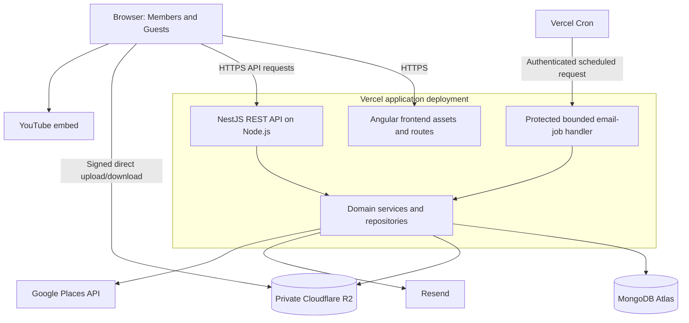
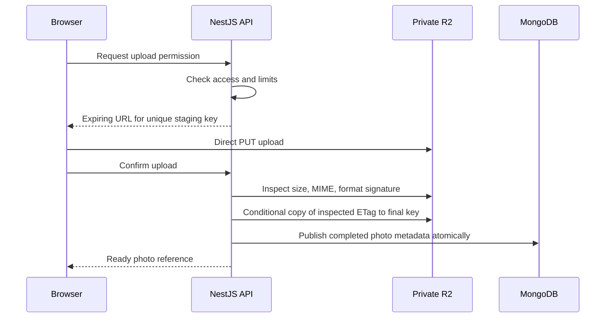

# Make My Marriage — Final System Architecture Design

**Version:** 1.0  
**Status:** Final architecture baseline  
**Date:** 6 November 2026  
**Architecture:** TypeScript modular monolith  
**Stack:** Angular 21 + NestJS on Node.js

## 1. Purpose and source of truth

This document consolidates the supplied SYSTEM_DESIGN.md and subsequent user decisions. It replaces earlier architecture drafts. The updated PRD remains the product reference, except where later decisions explicitly supersede it.

The latest guest-model decision is authoritative: **one RSVP status and one attending headcount per invitation, applying across its invited events**. There is no per-event RSVP record.

This document defines system components, boundaries, data ownership, security, integrations, deployment, and operational behavior. Detailed schemas, API payloads, folder structures, frontend component design, and deployment configuration belong in follow-on documents.

This is an architecture baseline, not evidence of a working deployment. Implementation and test notes in the supplied document have not been independently verified. References to unavailable API/database documents do not establish their contracts here.

## 2. Final decisions

| Area | Decision |
|---|---|
| Frontend | Angular 21 and TypeScript |
| Backend | NestJS controllers/services running on Node.js |
| API | REST |
| Architecture | Modular monolith, one coordinated application release |
| Persistence | MongoDB Atlas with Mongoose |
| Input validation | Zod |
| Authentication | Application-managed email/password, server-side sessions, secure cookies |
| Email verification | Not required in V1 |
| Media | Private Cloudflare R2; direct signed uploads |
| Email | Resend |
| Bulk delivery | MongoDB email jobs and bounded Vercel Cron batches |
| Vendor discovery | Google Places API through an adapter |
| Livestream | YouTube embed |
| Hosting | Vercel |
| Logging | Application and Vercel logs |
| Realtime / analytics | Neither included initially |

Cloudflare R2 replaces the earlier Amazon S3 choice. Using the AWS S3 SDK against R2's compatible API does not mean Amazon S3 is the storage provider.

Product rules retained:

- One wedding per registered user; multiple members and Admins per wedding.
- Only Admins manage members and roles. Managers have other wedding-management capabilities.
- Guests are invitation contacts, not accounts or individual household rosters.
- Expenses record spent or committed amounts. No budgets, allocations, balances, or payment schedules.
- Public events are explicitly selected. Gallery access remains private.
- No vendor booking transactions, guest accounts, photo moderation, or real-time collaboration.

## 3. Goals and sizing

Prioritize simplicity, clear domain ownership, mobile guest usability, tenant isolation, and low infrastructure overhead.

Sizing targets are up to approximately 1,000 guest invitation records and 5,000 photos per wedding, with thousands of weddings over time. These are design targets, not tested capacity guarantees or free-tier entitlements.

At 10 MiB per image, 5,000 images approach 49 GiB for one wedding before temporary objects. Actual usage must be bounded by storage quotas and selected provider plans.

V1 does not require microservices, Redis, Kafka, RabbitMQ, BullMQ, GraphQL, WebSockets, Kubernetes, a separate authentication provider, a dedicated image-processing service, or an analytics platform.

## 4. High-level architecture



Angular runs the frontend; NestJS defines the backend; Node.js executes backend code. They are separate code boundaries within one product, not a backend implemented inside Angular.

The modular monolith is a logical architecture. Vercel may execute multiple isolated runtime instances, so business state, sessions, job ownership, and rate-limit counters cannot depend on one process's memory.

### Deployment routing contract

| Path | Destination |
|---|---|
| `/api/*` | NestJS API runtime |
| Angular static assets | Static delivery |
| `/app/*`, `/w/*`, `/invite/*`, `/gallery/*`, account routes | Angular routing |
| `/api/internal/jobs/email` | Secret-protected NestJS cron handler |

Target one repository, one public origin, and one coordinated Vercel deployment. Verify the combined Angular build output and NestJS entry point with a deployment spike. Frontend fallbacks must not swallow API errors or missing assets. Vercel documents NestJS support; combined build configuration still needs verification. [NestJS on Vercel](https://vercel.com/docs/frameworks/backend/nestjs)

## 5. Application surfaces

### Private organizer dashboard

`/app/*` requires an organizer session and current wedding membership. It contains events, tasks, guests, invitations, RSVP summaries, expenses, vendors, website configuration, gallery, livestream, settings, and member administration.

Only member administration is Admin-only. Managers can publish the website and manage other agreed features.

### Public wedding website

`/w/{slug}` returns intentionally published couple details, cover, welcome text, public events, theme, and enabled livestream. Use a whitelisted response projection, not the full wedding record.

Exclude internal notes, expenses, tasks, guest contacts, private events, and gallery secrets. A public gallery section may explain guest access, but must not embed the private gallery URL or token. That link is distributed separately through private sharing and QR codes.

### Token-protected guest pages

- `/invite/{token}` resolves one invitation and its invited event details.
- `/gallery/{token}` grants wedding-level gallery viewing/upload access when enabled.

Guests do not register or create organizer sessions. An invitation token does not authorize gallery or member operations.

## 6. Backend domain boundaries

| Module | Owns |
|---|---|
| Auth | Signup, password hashes, login, sessions, logout, password reset |
| Wedding | Identity, structured location, date, shared settings |
| Wedding Members | Invitations, membership, roles, final-admin protection |
| Events | Event details, visibility, relationships |
| Tasks | Assignment, priority, due dates, status |
| Guests | Contacts, capacity, invited events, invitation-level RSVP |
| Invitations | Stable sharing links, public projections, email requests |
| Expenses | Expense records and totals |
| Vendors | My Vendors and discovery orchestration |
| Wedding Website | Stable slug, themes, publication |
| Gallery | Upload authorization, metadata, finalization, private access, deletion |
| Livestream | YouTube URL/video validation and configuration |
| Email | Templates, Resend adapter, bulk jobs |
| Infrastructure | Database connections, storage adapter, configuration, logs, throttling |

```text
NestJS Controller
 -> Authentication and authorization
 -> Zod request validation
 -> Domain service
 -> Repository / provider adapter
 -> Safe response projection
```

Controllers remain thin. Services implement business rules and cross-entity checks. Repositories enforce wedding-scoped persistence. Cross-module work uses exported services. External SDK calls remain inside adapters.

## 7. Data ownership and consistency

Wedding is the tenant boundary:

```text
User
  |
Wedding Membership [ADMIN | MANAGER]
  |
Wedding
  +-- Events
  +-- Tasks
  +-- Guests / Invitations
  +-- Vendors
  +-- Expenses
  +-- Website Settings
  +-- Photos / Gallery Settings
  +-- Livestream Configuration
```

Use separate collections for growing entities rather than embedding every guest, task, and photo inside one wedding. Exact schemas and collection names remain database-design work.

Required invariants:

- Unique normalized account email.
- At most one membership per user.
- At least one Admin per wedding.
- Unique, stable wedding slug.
- Every event, assignee, vendor, and photo reference belongs to the same wedding.
- Guest attending count never exceeds its maximum.
- Vendor agreed costs never implicitly increase expense totals.

Enforce uniqueness in MongoDB as well as application validation. Use transactions for wedding creation plus initial membership and invitation acceptance plus membership creation. Final-admin protection must handle concurrent changes; count-then-delete without concurrency protection is insufficient.

Reuse Mongoose connections within runtime instances where possible. Bound pool sizes because multiple Vercel instances may coexist. Do not open and close connections per request or assume all requests share one instance.

Use wedding-scoped indexes and bounded pagination. Store money in integer minor units, displayed as INR. Event instants use an explicit wedding timezone; date-only fields retain date-only semantics.

## 8. Simplified guest and RSVP model

```text
Guest
  +-- Wedding
  +-- Name and optional contact details
  +-- Maximum Guests Allowed
  +-- Invited Events[]
  +-- RSVP Status
  +-- Number Attending
  +-- Stable Invitation Token
  +-- Notes
```

There is no per-event RSVP, household model, or accompanying-person roster.

| Status | Attending count |
|---|---|
| PENDING | null; no response yet; contributes zero people to totals |
| ATTENDING | Integer from 1 through maximum allowed |
| NOT_ATTENDING | 0 |

The count includes the named guest. A maximum of four means four total people, not the named guest plus four.

One saved response applies across all invited events. Guests cannot choose different attendance or headcounts for different events in V1. This intentionally replaces the earlier per-event decision.

### RSVP flow

1. Resolve the unpredictable token and available guest/wedding.
2. Load only active invited events belonging to that wedding.
3. Return a minimal public invitation projection.
4. Validate status and headcount.
5. Atomically save against the current version and capacity.
6. Return saved state; repeated identical submissions do not create duplicates.

Guests can update their response through the same URL. Concurrent organizer edits must not be silently overwritten. Reject stale updates that conflict with changed capacity or invitation details.

Reporting distinguishes invitation records from people. Event attendance is derived from attending guests invited to that event, using each guest's common response. Summing people across events does not produce unique wedding attendees.

## 9. Authentication and membership

### Account lifecycle

Signup requires name, email, and password. Normalize email, validate input, use an established password-hashing library, create the account, and establish a session. No email-verification step is required in V1.

A user then creates a wedding or accepts a member invitation. Pending invitation acceptance takes precedence over create-wedding onboarding. No custom cryptographic primitives are implemented.

### Sessions and recovery

Use random opaque session tokens in secure cookies, with HMAC-hashed lookup stored in MongoDB. Cookies do not contain trusted role or wedding claims.

Use HttpOnly, Secure in production, appropriate SameSite, and narrow host scope. Cookie-authenticated mutations require CSRF defenses, including origin validation and CSRF tokens as appropriate. Check expiry during requests; TTL cleanup alone is insufficient.

Logout invalidates the server session and removes the cookie. Password reset uses a short-lived, single-use token sent through Resend. Security design must define reset-session policy; revoking existing sessions is the recommended default.

### Member invitation

An Admin creates an email-bound invitation containing wedding, intended role, HMAC-hashed token, expiry, and status. The recipient signs up or logs in and presents the invitation secret while authenticated as the intended email.

A matching email string alone is not sufficient, particularly because signup does not verify mailbox ownership. Reject users already belonging to another wedding. Consume the invitation atomically with membership creation.

### Authorization

```text
Validate Session
 -> Resolve User
 -> Resolve Current Membership
 -> Check Role
 -> Query by Object ID AND Current Wedding ID
 -> Apply Business Rules
```

Only Admins invite/remove members or change roles. Removed members lose access on subsequent requests. Frontend guards improve navigation; backend checks enforce access.

## 10. Guest tokens and privacy

Retain the supplied design's stable-sharing exception: a high-entropy random invitation token is retrievable from the Guest record for an explicitly authorized sharing operation.

Exclude this bearer secret from ordinary queries, guest CRUD responses, logs, and analytics. Session and member-invitation tokens retain HMAC-hashed storage. Database design must also support secure retrieval or reproduction of the stable gallery URL without exposing it through public wedding responses.

Private pages use no-store, no-referrer, and noindex protections. These reduce leakage but do not replace authorization. Anyone possessing a valid gallery link can exercise its enabled capabilities.

Routine settings changes preserve the gallery URL and printed QR codes. Disabling the gallery blocks new access without changing its URL. Emergency token rotation revokes a leaked link but breaks old printed QR codes; both permanent validity and revocation cannot be promised for the same secret. Rotation is an operational recovery procedure in V1, with no organizer self-service UI or API endpoint.

## 11. Website and livestream

Generate a normalized names-and-date slug with a collision suffix. Later edits to names/date do not automatically change the URL.

Themes are Angular presentation components over one view model, such as Classic, Minimal, and Modern. A theme switch changes layout, not data.

Public visibility is independent of invitation membership: private invitations may show events absent from the public website. Start with Angular client-rendered pages; custom social-preview metadata/server rendering are separate frontend decisions.

Validate YouTube URLs and store an approved URL or video ID. Render a trusted embed, not arbitrary user-provided iframe HTML. Unavailable streams show a fallback. No broadcasting infrastructure is built.

## 12. Vendors, location, and expenses

My Vendors stores wedding-owned contact details, categories, zero or more related events, agreed cost, and notes. Vendors can be saved before events are assigned. Vendors may exist without expenses and vice versa. There are no booking transactions, vendor accounts, or payment schedules. Archived events and vendors are read-only; restoration is deferred beyond V1.

VendorDiscoveryService calls Google Places from the backend. Accept category, text query, or both, requiring at least one. Default searches to the wedding's coordinates while allowing a coordinate override; reject searches without usable coordinates. Use structured location where available: formatted address, city, state, country, coordinates, and place ID.

Adding discovery results must respect provider storage and attribution rules. Do not assume every returned field may be stored indefinitely. Retain permitted IDs and independently provided organizer details, and refresh/store other content only as allowed. Manual vendor records remain usable during discovery outages. [Google Places policies](https://developers.google.com/maps/documentation/places/web-service/policies)

Expenses record amount, date, category, description, and optional event/vendor. Totals represent recorded spent or committed amounts, not necessarily cash paid. No budget or variance calculations are present.

## 13. Private media architecture

MongoDB stores metadata; private Cloudflare R2 stores image bytes. Use separate environment credentials and a server-only storage adapter. S3-compatible presigned requests allow browser transfers without exposing storage credentials. [R2 presigned URLs](https://developers.cloudflare.com/r2/api/s3/presigned-urls/)



### Upload controls

- Check membership or gallery capability during authorization and finalization.
- Validate allowed type, declared size, file count, upload limits, and expiry.
- Use unique server-selected staging keys and narrowly scoped permissions.
- Inspect actual stored size, declared content type, and format signature before publication.
- Pin inspection and copying to the same ETag; reject changed bytes.
- Copy into an independent final key inaccessible to the upload URL.
- Make confirmation idempotent so retries cannot create duplicate photos.

The initial lightweight checks follow the supplied design. A 16-byte format signature is not a full image decode or malware scan. Keep allowed formats narrow, exclude executable/vector formats, and use safe response content types.

R2 supports conditional-copy extensions; verify exact SDK and ETag behavior during storage implementation. [R2 conditional operations](https://developers.cloudflare.com/r2/api/s3/extensions/)

Use 10 MiB per image as an initial configurable ceiling. Define aggregate wedding quota, per-request file count, and upload rate limits before real usage. Configure R2 CORS for required app origins, GET/PUT/HEAD, and signed headers; CORS is not authorization.

### Viewing, deletion, and failures

Return short-lived signed read URLs only after member/gallery authorization. Original downloads travel directly from R2 to the browser. Never expose the bucket publicly or put private images into a public image cache.

Initial browsing uses cursor pagination and lazy-loaded originals, with uncropped images in the viewer. Thumbnails and optimization remain deferred; one viewed image may transfer up to 10 MiB. Guest images appear after technical validation without an organizer moderation queue.

Deletion hides the image from application listings and coordinates storage deletion with metadata state. Retries must be safe when only one side succeeds. Disabling the gallery stops new read URLs; already-issued URLs can remain valid until expiry unless their objects are deleted.

Automated orphan reconciliation is deferred in accordance with the supplied design. Before real uploads, document manual inspection/removal and monitor storage usage. Finalization must never publish an unverified or missing object.

Selected files and partial progress may remain in memory across same-tab login recovery. Changing user/wedding clears the draft. Refreshing or closing the tab loses File objects; no persistent file cache is stored in localStorage.

## 14. Email and scheduled processing

EmailService owns templates and the Resend adapter. Supported messages include password reset, member invitations, guest invitations, and organizer-triggered RSVP reminders.

### Individual messages

Attempt transactional messages synchronously or within a bounded request lifecycle. Record provider acceptance or failure and offer a controlled retry. Never report failure as delivered or rely on untracked execution after the response.

### Bulk messages

Create MongoDB jobs and return a queued status. A protected Vercel Cron endpoint processes bounded batches, initially configurable around 25–50 messages.

```text
PENDING -> PROCESSING -> SENT
                   -> Retry scheduled
                   -> FAILED
```

Use atomic leased claims so overlapping invocations do not own the same job and crashed jobs can recover. Limit retries, apply backoff, and respect provider rates and the function's remaining time.

Use provider idempotency where available. Delivery is otherwise at-least-once across failures: a provider may accept a message before the application records success. SENT means provider acceptance, not guaranteed inbox delivery. Before sending a pending-RSVP reminder, recheck the guest's invitation-level status.

Cron requests require a server secret. Vercel invokes a production route; handlers must complete within runtime limits. [Vercel Cron](https://vercel.com/docs/cron-jobs)

### Free-tier scheduling constraint

Vercel's documented Hobby cron limit is once per day per job, with imprecise timing. A single daily invocation processing 50 jobs takes approximately 20 days to clear 1,000 jobs, excluding retries and email-provider limits. This cannot support timely wedding-wide delivery.

Keep MongoDB jobs plus Vercel Cron as the selected architecture, but frequent production campaigns require a suitable plan or a separately approved scheduler change. A free-tier demonstration must label bulk delivery as queued/delayed rather than promise prompt delivery. Individual sends do not wait for this cron cycle. [Vercel Cron usage and pricing](https://vercel.com/docs/cron-jobs/usage-and-pricing)

## 15. API, validation, and security

REST areas include `/api/auth`, `/api/wedding`, `/api/members`, `/api/events`, `/api/tasks`, `/api/guests`, `/api/expenses`, `/api/vendors`, `/api/gallery`, and `/api/livestream`.

Use `/api/public/*` for public/token-authorized operations and `/api/internal/*` for protected infrastructure endpoints. Public does not mean unrestricted: guest operations still validate their capabilities.

Zod validates external inputs; Mongoose protects persistence structure. Neither replaces authorization or business rules. Reject unexpected fields and bound pagination, filters, and payload sizes.

Return consistent safe errors: validation, unauthenticated, forbidden, not found, conflict, rate limited, provider unavailable, and internal error. Invalid/deleted guest links use generic unavailable states. Do not expose stack traces.

### Rate limits

Use MongoDB-backed atomic counters so limits apply across runtime instances. Protect authentication, reset requests, email, RSVP, discovery, and upload authorization. HMAC-derived identifiers avoid storing raw guest tokens in counters.

The supplied RSVP values—20 writes per invitation per 15 minutes and 300 valid writes per minute globally—are initial configurable policy values, not capacity guarantees. Apply invitation admission before the shared valid-write quota. Separate request/IP controls protect invalid-token traffic. Authorization, capacity checks, and throttling are all necessary.

### Secrets

Keep MongoDB URI, session/HMAC keys, R2 credentials, Resend key, Google Places key, and cron secret in server-only configuration. Never embed them in Angular assets. Redact tokens, cookies, signed URLs, and token-bearing request paths from logs.

## 16. Deployment and operations

Vercel serves static Angular assets and executes NestJS on its managed Node runtime. No logic assumes a permanent process, durable local filesystem, or in-process polling loop. Cron is the selected trigger for bulk jobs.

Maintain isolated local and production data/credentials. Preview deployments require their own safe configuration. Production buckets and real guest records must not be accidental test fixtures.

Reuse connections where available, bound concurrency, and cache static assets normally. Private invitation/gallery responses are not publicly cacheable. No Redis layer is required initially.

Application and Vercel logs record request IDs, operation names, safe internal identifiers, failures, and job outcomes. No external observability or product analytics platform is introduced.

Deployment verification must cover:

- Angular/NestJS build compatibility and correct `/api` routing.
- Direct frontend links and asset fallback behavior.
- Secure cookie and CSRF behavior on the production origin.
- Cron authentication and actual plan-supported frequency.
- MongoDB pool sizes, permissions, and indexes.
- R2 signed operations, CORS, credentials, and privacy.
- Resend sender setup and delivery limits.
- Google Places field usage, attribution, quotas, and billing controls.

Free tiers are a preference, not a guarantee of zero cost. Choosing paid plans or provisioning services is separate from approving this document.

Before storing irreplaceable wedding data, define an affordable backup/export and restore process supported by the chosen database/storage plans. Logs alone are not backups.

## 17. Failure handling and consistency

| Failure | Required behavior |
|---|---|
| MongoDB unavailable | Controlled failure; no false success for unpersisted mutations |
| Wedding/membership partial write | Transaction or safe compensation preserves invariants |
| Concurrent Admin removal | Prevent zero-Admin result |
| Resend rejection | Individual error or durable bulk retry |
| Cron overlap/crash | Atomic leases and expiry recovery |
| Discovery outage | Existing vendors and planning remain usable |
| R2 upload failure | Do not publish completed photo metadata; show retryable state |
| Uploaded object, failed finalization | Safe confirmation retry and reconciliation information |
| Partial photo deletion | Consistent hiding and retry; no false full-deletion claim |
| YouTube failure | Website remains usable with fallback |
| Concurrent RSVP/capacity change | Reject stale invalid update |
| Event deletion | Warn and apply explicit relationship cleanup |

Soft-delete rules and detailed cleanup belong to database design. Removing an invited event does not remove an independent RSVP because none exists; the guest retains its common response for remaining events.

## 18. Performance and scaling

Stage 1 uses the selected services with indexed wedding queries, pagination, direct media transfer, connection reuse, and bounded email batches.

Stage 2 improves measured bottlenecks: MongoDB query plans, pool limits, discovery usage, media delivery, email throughput, and rate-counter contention. Thumbnail generation can be considered when original-image browsing proves too slow or expensive.

Stage 3 may introduce a dedicated queue, worker, cache, or specialized media service only when justified by demand. These are future decisions, not V1 prerequisites.

Angular refreshes data after mutations, navigation, or explicit refresh. No live synchronization between organizers is promised.

## 19. Testing and architecture acceptance

Support unit, integration, authorization, and browser-journey tests. Required checks include:

- A user cannot create/join two weddings, including concurrent requests.
- A wedding cannot lose its final Admin.
- Managers cannot administer members but retain other agreed permissions.
- Cross-wedding IDs cannot expose or mutate another tenant's records.
- Guest tokens expose only their own invitation and allowed events.
- RSVP saves one invitation-level status/count, without duplicate records.
- Headcount includes the named guest and obeys the latest capacity.
- Public pages omit private events, planning records, and gallery secrets.
- Gallery tokens cannot authorize organizer actions.
- Invalid/disabled tokens cannot upload.
- Finalization detects changed/invalid objects and handles retries safely.
- Private media is not publicly cached.
- Expired/used reset and member-invitation tokens fail.
- Bulk claims recover after crashes and honor provider limits.
- Theme changes preserve content and published URLs remain stable.

Browser journeys cover signup, create/join wedding, event/task creation, guest invitation, RSVP, vendor/expense entry, website publishing, mobile gallery upload, QR access, and livestream fallback.

Tests mentioned in the supplied document were not rerun. This final architecture does not certify implementation completeness or production readiness.

## 20. Decision register

| ID | Decision | Rationale |
|---|---|---|
| ADR-01 | Modular monolith | Manageable solo-developer scope |
| ADR-02 | Angular + NestJS + Node.js | Confirmed frontend/backend stack |
| ADR-03 | Atlas + Mongoose + Zod | Managed data with separate validation boundaries |
| ADR-04 | Application-managed sessions | Browser-focused authentication and revocation |
| ADR-05 | No signup email verification | Confirmed V1 scope; invitations still require their secrets |
| ADR-06 | Wedding tenant isolation | Uniform private-data boundary |
| ADR-07 | Invitation-level RSVP | Explicit simplified guest-model decision |
| ADR-08 | Stable guest/gallery tokens | Account-free guest participation |
| ADR-09 | Private direct R2 uploads | Media bypasses backend transfer path |
| ADR-10 | Resend + MongoDB jobs + Vercel Cron | Small infrastructure footprint with scheduling constraints documented |
| ADR-11 | Google Places adapter | Discovery without a proprietary marketplace |
| ADR-12 | Vercel deployment | Managed runtime and static delivery |
| ADR-13 | Public website/private gallery separation | Preserve agreed photo privacy |
| ADR-14 | Original photos initially | Defer derivatives and dedicated processing |

## 21. Follow-on design documents

The system-level architecture is finalized. Implementation details remain in these planned documents:

1. **Database design:** collections, relationships, indexes, token fields, constraints, deletion rules, sessions, and email jobs.
2. **API design:** payloads, projections, authorization, errors, RSVP concurrency, media finalization, and sharing operations.
3. **Module design:** NestJS controllers, services, repositories, adapters, and dependencies.
4. **Frontend architecture:** Angular routes, components, layouts, forms, state, and mobile guest flows.
5. **Security design:** hashing, session lifetime, CSRF, token lifecycle, rate limits, upload validation, and secret rotation.
6. **Deployment design:** combined build, Vercel routing, environments, cron plan/cadence, backup process, and release verification.

Unresolved implementation parameters include storage quota, file-count limits, exact package versions, session/reset lifetimes, retention periods, and production cron frequency. They do not change the selected system boundaries.

## 22. Final baseline

Make My Marriage is a TypeScript modular monolith with Angular 21 and a NestJS backend running on Node.js. Weddings isolate private data. Organizers use server-side sessions, while guests use invitation and gallery links without accounts.

Each invitation has one RSVP status and one headcount across its invited events. MongoDB Atlas stores records, private R2 stores media, Resend delivers email, Vercel Cron processes bulk jobs, Google Places supplies discovery, and YouTube supplies livestream playback.

This final document resolves the earlier framework and RSVP inconsistencies while retaining the selected providers and private-gallery decision. It defines the design to implement without claiming that the application has already been built, tested, or deployed.
